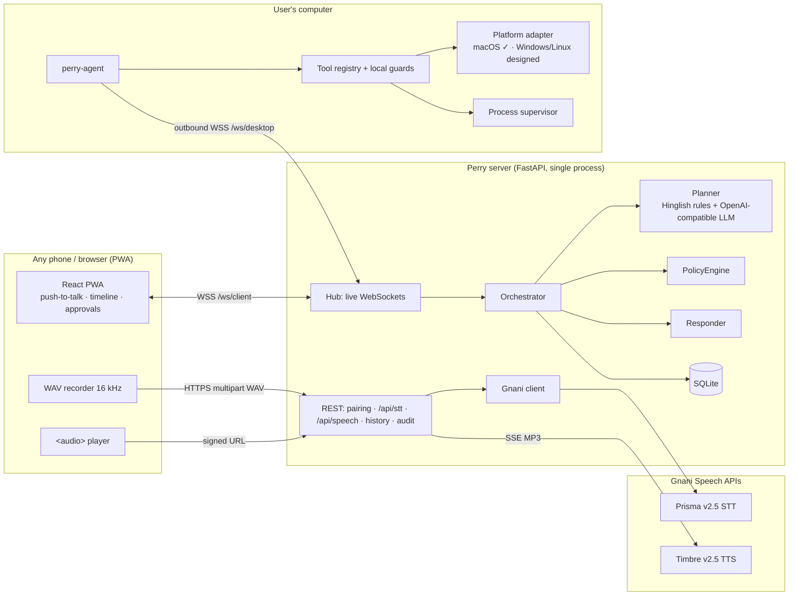
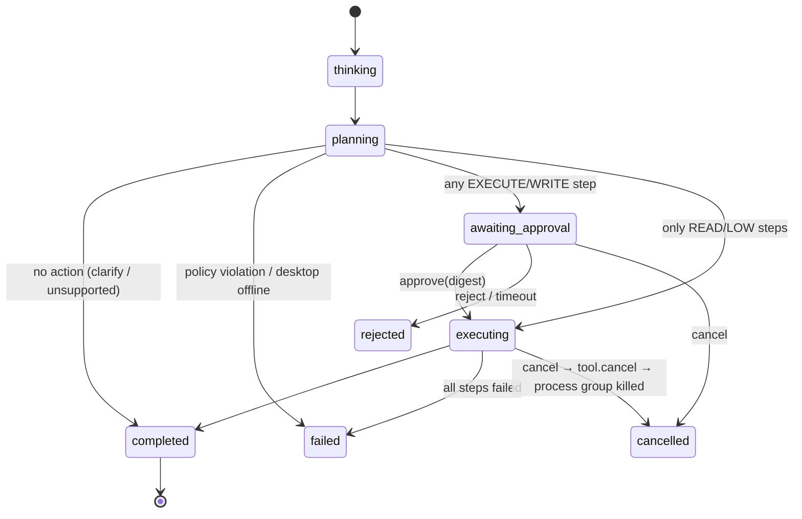
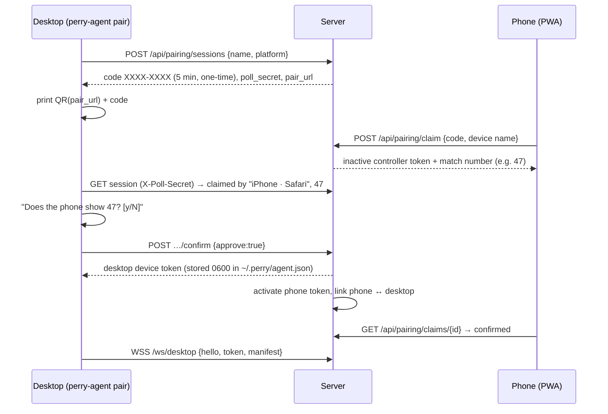

# System architecture



Layers: **(1) UI** — one responsive PWA for Android Chrome, iPhone Safari and desktop browsers;
**(2) orchestration** — server; **(3) execution** — desktop agent; **(4) tools** — typed registry.

## Voice lifecycle

1. Tap the orb → `getUserMedia` → ScriptProcessor captures PCM → downsampled to 16 kHz mono 16-bit **WAV**
   (Prisma REST accepts wav/mp3/ogg/flac/aac/m4a, not WebM; max 30 s, we stop at 28 s).
2. `POST /api/stt` (Bearer token) → server adds word-boosting (`bias_list` = project names + command words)
   → **Prisma v2.5** `POST https://api.vachana.ai/stt/v3` with `language_code` (`en-IN` for Hinglish:
   Gnani documents it as accepting Hindi-English mixed audio and writing Latin script).
3. Transcript shown, then sent as a `command` over the WebSocket.
4. Reply text → `SpeechService.prepare` returns an HMAC-signed `/api/speech/{id}` URL (15 min) →
   the phone's `<audio>` requests it → server streams **Timbre v2.5** SSE (`/api/v1/tts/sse`,
   `container=mp3`) chunk by chunk; REST `/tts/inference` is the fallback (still Timbre). Hinglish
   replies use voice **Poorvi** (`hi-en`), English replies **Kaveri** (`en-IN`).
5. If Gnani is not configured or fails, the UI says so. There is no silent fallback to another vendor.

## Tool-execution lifecycle (task state machine)



Steps run in order; the first failure skips the rest. Each step is a `tool.call`
(`call_id, tool, args, risk, approved, timeout_s`) answered by `tool.progress*` and one `tool.result`.
The reply is composed from structured result fields only (`compose_reply`). Every task snapshot is
persisted (SQLite) and pushed to all of the controller's open sockets, so a reconnecting phone
resyncs from the `ready` frame.

## Pairing lifecycle



Revocation (`DELETE /api/desktops/{id}`) unlinks; when no phone remains the desktop record and token are
deleted and a connected agent receives `revoked`, closes, and wipes its local credentials. Multiple
desktops per phone and multiple phones per desktop are supported by the `pairings` table.

## Connection health

- Desktop: server `ping` every 15 s; no traffic for 45 s ⇒ socket closed, desktop marked offline, all
  phones notified. Agent reconnects with jittered exponential backoff (1 s → 30 s).
- Phone: app-level ping every 20 s; reconnect with backoff and immediately on `visibilitychange`.

## Platform adapters

`PlatformAdapter` (`src/perry_agent/platform/base.py`): `list_apps, open_app, focus_app, open_url,
open_in_editor, reveal_in_file_manager, notify, browser_tabs, detect_editor, version`.

| Adapter | Status |
|---|---|
| `MacOSAdapter` | Implemented and tested on macOS 27 (LaunchServices `open`, `osascript` with argv, `/Applications` scan) |
| `WindowsAdapter` | Interface only — `supported = False`, every call raises `NotImplementedError` |
| `LinuxAdapter` | Interface only — same |

Process management, git and package scripts are cross-platform Python already; the adapters are what
remains to port.

## Repository layout

```
src/perry_protocol/   shared Pydantic wire models (Risk, ToolSpec, Plan, ToolCall, …)
src/perry_server/     FastAPI app, auth/pairing, hub, orchestrator, planners, policy, responder, Gnani
src/perry_agent/      desktop agent CLI, outbound link, tool registry, tools, adapters, process supervisor
web/                   React + Vite + Tailwind PWA
tests/                 pytest: planner, policy, agent guards, pairing + WebSocket loop
scripts/               gnani_smoke.py, e2e_headless.py, ui_check.mjs, dev_up.sh
```
